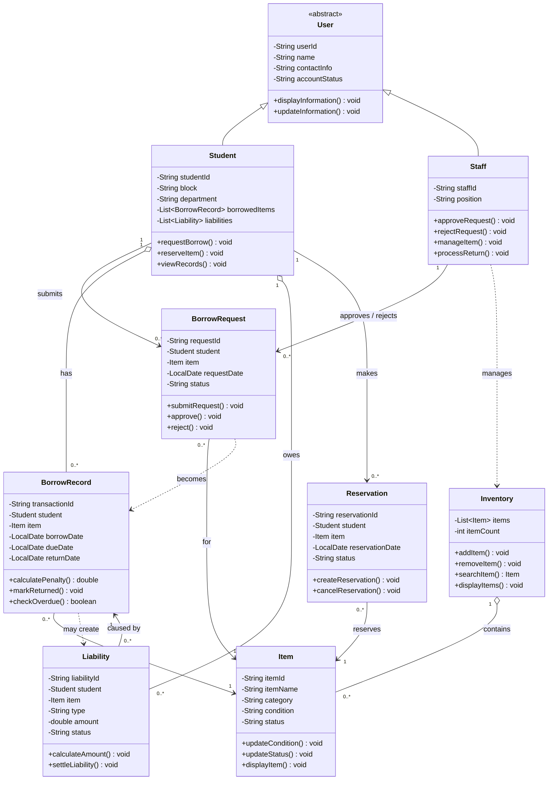

# 📚 HiramMate

A Java-based borrowing and inventory management application for the College of Informatics and Computing Sciences (CICS). Students can search for school items, check availability, request or reserve items, and track due dates, while authorized staff manage inventory, approve requests, record returns, and monitor overdue items and liabilities.

> **Note:** HiramMate is a school project developed for OOP 101 (Object-Oriented Programming). Penalties and liabilities in the system follow the rules defined by the team and are for demonstration purposes only.

## Features

- **User Registration** – register student information and choose whether to borrow or donate items
- **Item Management** – staff can add, edit, remove, and update school items and their information
- **Item Search & Availability** – search for items and see if they are available, borrowed, reserved, damaged, or unavailable
- **Borrow Request & Approval** – request available items for a chosen borrowing period; staff approve or reject based on student eligibility and item availability
- **Reservation** – reserve an item that is currently borrowed, subject to reservation rules
- **Item Condition Tracking** – record the condition of an item before it is borrowed and after it is returned
- **Due Date & Overdue Tracking** – identify items that have passed their due date
- **Return Tracking** – record the actual return date and update the item's availability
- **Borrowing Limits** – limit the number of items a student can borrow and the maximum days an item can be kept
- **Liability Management** – calculate or record penalties for late, damaged, lost, or unreturned items
- **Dashboard Summary** – view the number of available, borrowed, overdue, reserved, and pending items

## Target Users

| User | How they use the system |
| --- | --- |
| **CICS Students** | Register, search for items, submit borrow or reservation requests, view borrowing records, check due dates, and monitor liabilities |
| **Authorized School Staff / Org** | Manage inventory, review requests, approve or reject borrowing, record item release and return, check item condition, and monitor overdue items and liabilities |

## Getting Started

Follow the instructions below to get a local copy of **HiramMate** up and running.

```bash
javac *.java
java HiramMate
```

> Replace `HiramMate` with the name of your class that contains the `main` method if it is different.

## Java and OOP Concepts Used

| Concept | Where it is used |
| --- | --- |
| Classes and Objects | Classes such as `Student`, `Item`, `BorrowRequest`, and `BorrowRecord` represent the main entities of the system. Objects represent actual students, items, and transactions. |
| Methods | Methods handle actions such as requesting to borrow, reserving items, approving or rejecting requests, processing returns, checking overdue items, and calculating penalties. |
| Encapsulation | Important attributes such as student information, item status, and borrowing details are declared `private` and accessed through getters and setters. |
| Inheritance | A general `User` class is the parent class of `Student` and `Staff`. |
| Polymorphism | Different user types provide their own implementation of methods such as displaying user information or handling permissions. |
| Abstraction | `User` is an abstract class that defines common behavior while allowing `Student` and `Staff` to implement their own. |
| Exception Handling | `try-catch` and custom exceptions handle invalid inputs, unavailable items, invalid borrowing periods, and other system errors. |
| Arrays / Data Handling | Arrays or Java collections (e.g. `List`) store and manage students, items, borrowing records, and requests. |

## Proposed Classes

| Class | Purpose | Main Attributes | Main Methods |
| --- | --- | --- | --- |
| `User` *(abstract)* | Parent class for system users | userId, name, contactInfo, accountStatus | displayInformation(), updateInformation() |
| `Student` | A student who can borrow or reserve items | studentId, block, department, borrowedItems, liabilities | requestBorrow(), reserveItem(), viewRecords() |
| `Staff` | Authorized personnel who manage the system | staffId, position | approveRequest(), rejectRequest(), manageItem(), processReturn() |
| `Item` | A school item available for borrowing | itemId, itemName, category, condition, status | updateCondition(), updateStatus(), displayItem() |
| `BorrowRequest` | A student's request to borrow an item | requestId, student, item, requestDate, status | submitRequest(), approve(), reject() |
| `BorrowRecord` | The record of an approved borrow transaction | transactionId, student, item, borrowDate, dueDate, returnDate | calculatePenalty(), markReturned(), checkOverdue() |
| `Reservation` | A student's reservation for an unavailable item | reservationId, student, item, reservationDate, status | createReservation(), cancelReservation() |
| `Liability` | Penalties caused by late, damaged, lost, or unreturned items | liabilityId, student, item, type, amount, status | calculateAmount(), settleLiability() |
| `Inventory` | Manages the collection of school items | items, itemCount | addItem(), removeItem(), searchItem(), displayItems() |

## Class Diagram



## Program Flow

**Student**

1. Login / Register → Student Dashboard
2. Search for an item and check availability
3. System checks borrowing limit and existing liabilities
4. Select **Borrow** or **Reserve**, then review and agree to the terms and conditions
5. Submit the request and wait for staff approval
6. If approved, the item is released and the borrowing period begins
7. Return the item; staff check its condition and due date
8. A penalty/liability is calculated if necessary, the record is updated, and the item becomes available again

**Staff**

1. Login → Staff Dashboard
2. Manage items and review borrow requests
3. Check student eligibility, then approve or reject
4. Release the item and monitor due dates
5. Process returned items and check their condition
6. Record a penalty/liability if necessary, update the inventory, and return to the dashboard

## Limitations

1. The application is Java-based and does not include multi-campus inventory management.
2. Access is limited to CICS students and authorized school staff; public access for users outside CICS is not supported.
3. The available items are limited to the school-owned items recorded by the development team.
4. Borrowing limits, penalties, and liabilities follow the rules defined in the system.

## Development Schedule

| Week | Activity | Expected Output |
| --- | --- | --- |
| Week 1 | Planning and requirements | Project proposal |
| Week 2 | System and class design | Class/UML diagram |
| Week 3 | Initial coding | Basic classes |
| Week 4–5 | Feature development | Working features |
| Week 6 | OOP implementation | Completed OOP features |
| Week 7 | Testing and debugging | Tested application |
| Week 8 | Documentation and presentation | Final project |

## Team

**Team DINOROBONG TUBO** (Team 2, CS-2102) — OOP 101, 1st Semester, AY 2026–2027

- Gian Carlo M. Arago ([@gianaragoworks](https://github.com/gianaragoworks)) – Team Leader, Lead Programmer
- Renzo C. Panes ([@renzocruzpanes](https://github.com/renzocruzpanes)) – System UI Design, Documentation
- Anthony S. Soreta ([@thonsilitis](https://github.com/thonsilitis)) – Data Handling

**Instructor:** Ms. Fatima Marie P. Agdon, MSCS
